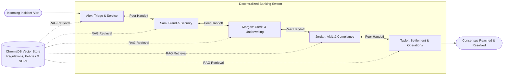

# Autonomous Banking Swarm: Multi-Agent Incident Response System

## 1. Executive Summary

This project implements a decentralized **Swarm Topology** using **LangGraph**, **ChromaDB (RAG)**, and **Meta's Developer Model API (Muse family: `muse-spark`)**. 

In conventional multi-agent setups, a centralized supervisor or manager acts as a bottleneck, inspecting every message and directing traffic. In contrast, this **Swarm Architecture** operates through autonomous peer-to-peer deliberations: each banking specialist agent possesses dedicated domain tools, queries a vector knowledge base for regulatory SOPs, executes core actions, and hands off the conversation to the most qualified peer agent until the incident is fully resolved.



---

## 2. The 5 Banking Specialist Agents

Each agent has a specific persona, regulatory domain, toolset, and ChromaDB query targets:

| Agent Name | Role | Primary Responsibility | Core Domain Tools | ChromaDB RAG Knowledge |
| :--- | :--- | :--- | :--- | :--- |
| **Alex** | Customer Triage Specialist | Frontline validation, Regulation E liability determination, initial case intake. | `tool_consult_rag`, claim initiation. | `dispute_policy.md` (Reg E timelines, liability tiers). |
| **Sam** | Fraud & Security Specialist | Geo-velocity anomaly analysis, risk scoring, threat containment. | `tool_freeze_card`, OAuth session revocation. | `fraud_security_sop.md` (Composite risk scoring, impossible travel). |
| **Morgan** | Loan & Credit Underwriter | Balance impact assessment, standing auto-debit protection, overdraft fee suppression. | `tool_protect_loan_debit`, FCRA dispute tagging. | `credit_underwriting_policy.md` (Grace periods, loan protections). |
| **Jordan** | AML & Regulatory Officer | FinCEN SAR analysis, OFAC SDN sanctions screening, regulatory audit logging. | `tool_check_aml_sar`, compliance auditing. | `compliance_aml_sop.md` (SAR thresholds, CTR, OFAC guidelines). |
| **Taylor** | Settlement & Operations Lead | General ledger contra-reversals, card network chargebacks, credential restitution. | `tool_post_provisional_credit`, `tool_issue_virtual_card`. | `settlement_operations_sop.md` (GL-7102 clearing, chargeback 10.4). |

---

## 3. ChromaDB Vector Store (RAG) Architecture

The Retrieval-Augmented Generation (RAG) subsystem is managed by `BankingVectorStore` located in [`rag/vector_store.py`](file:///Users/omprakashprajapat/AgentAI/HackathonDemo/rag/vector_store.py).

### Indexed Regulatory Policies & SOPs:
1. **`dispute_policy.md`**: Federal Reserve Regulation E (12 CFR Part 1005), 2-day vs 60-day notification limits ($50 vs $500 liability), and mandatory 10-day provisional credit posting rules.
2. **`fraud_security_sop.md`**: Impossible travel geo-velocity rules, Composite Risk Score (CRS > 70 requires `HARD_FREEZE`), and automated OAuth session termination.
3. **`credit_underwriting_policy.md`**: FCRA dispute non-derogatory protections, 14-day hold on internal loan auto-debits, and automatic NSF/overdraft fee waivers.
4. **`compliance_aml_sop.md`**: Bank Secrecy Act / AML SAR reporting thresholds ($5,000 suspect identification vs $25,000 threshold), and OFAC Specially Designated Nationals (SDN) registry screening.
5. **`settlement_operations_sop.md`**: General Ledger contra-account `GL-7102 (Disputed Clearing)`, Visa/Mastercard dispute code `10.4 (Card-Absent Fraud)`, and instant Virtual Debit Card (VDC) provisioning.

### Semantic Search:
Chunks are indexed into ChromaDB's persistent collection `banking_knowledge_base`. Agents invoke `tool_consult_rag(query, category)` during deliberations to cite exact policy provisions.

---

## 4. Meta Developer Platform: Muse API Integration

Meta provides its frontier reasoning models—the **Muse** family (`muse-spark`, `muse-wonder`)—via the **Meta Model API**:
- **Endpoint**: `https://api.meta.ai/v1`
- **Compatibility**: Drop-in compatible with Chat Completions API format.
- **Authentication**: Bearer token via `META_API_KEY` or `MODEL_API_KEY`.
- **Default Model**: `muse-spark` (optimized for fast multi-agent reasoning, long-horizon workflows, and complex tool calling).

### Code Integration:
In [`swarm/model_client.py`](file:///Users/omprakashprajapat/AgentAI/HackathonDemo/swarm/model_client.py), the client uses LangChain's `ChatOpenAI` initialized with Meta's endpoint:

```python
from langchain_openai import ChatOpenAI

def get_meta_muse_llm(temperature: float = 0.2):
    return ChatOpenAI(
        model="muse-spark",
        base_url="https://api.meta.ai/v1",
        api_key=os.getenv("META_API_KEY"),
        temperature=temperature,
    )
```

### Out-of-the-Box Simulation Mode:
To ensure instantaneous execution during hackathon demos, CI/CD, or offline environments, the system includes `SimulatedMuseModel`. When `META_API_KEY` is not detected, it executes deterministic, banking-intelligent reasoning while exercising all ChromaDB RAG queries and LangGraph state transitions.

---

## 5. LangGraph Swarm Implementation

The Swarm topology is implemented in [`swarm/graph.py`](file:///Users/omprakashprajapat/AgentAI/HackathonDemo/swarm/graph.py).

### Shared Swarm State (`agents/state.py`):
```python
class SwarmState(TypedDict, total=False):
    messages: List[Any]
    active_agent: str
    incident: IncidentData
    swarm_history: List[SwarmDeliberationRecord]
    resolution_summary: Optional[str]
    is_resolved: bool
```

### Dynamic Decentralized Routing:
Rather than returning to a central supervisor, the router checks `state["active_agent"]` which each agent dynamically assigns during its turn:

```python
def route_swarm(state: SwarmState) -> str:
    active = state.get("active_agent", "resolved")
    if active in ["resolved", "FINISH", "__end__", None]:
        return END
    return active
```

Conditional edges connect every node to the routing map, allowing agents to route directly to any peer.

---

## 6. Incident Walkthrough Scenario

In the demo scenario (`main.py`):
1. **The Alert**: Customer Alex Mercer reports an unapproved POS debit of **$2,450.00** from *Luxury European Watches Ltd* in Bucharest, Romania. Furthermore, Alex has an auto-loan debit of **$450.00** scheduled in 3 days that risks overdraft.
2. **Step 1 (Alex - Triage)**:
   - Queries ChromaDB: Regulation E policy.
   - Assesses customer liability: capped at $50 due to prompt reporting.
   - Hands off to: `fraud_agent`.
3. **Step 2 (Sam - Fraud)**:
   - Queries ChromaDB: Fraud SOP.
   - Detects Geo-Velocity anomaly: login in New York, transaction in Bucharest within 42 minutes (CRS = 88/100).
   - Tool action: Places `HARD_FREEZE` on card `4102` and terminates active mobile sessions.
   - Hands off to: `credit_agent`.
4. **Step 3 (Morgan - Credit Underwriting)**:
   - Queries ChromaDB: Credit policy.
   - Protects customer: Places 14-day hold on the $450 auto-loan payment, waives prospective overdraft/NSF penalties, and sets FCRA dispute suppression flag.
   - Hands off to: `compliance_agent`.
5. **Step 4 (Jordan - AML Compliance)**:
   - Queries ChromaDB: AML & SAR regulations.
   - Checks OFAC sanctions: Terminal location cleared.
   - Evaluates FinCEN SAR rules: logs internal incident dossier `SAR-REF-90214`.
   - Hands off to: `settlement_agent`.
6. **Step 5 (Taylor - Settlement Operations)**:
   - Queries ChromaDB: Settlement SOP.
   - Financial execution: Posts $2,450.00 provisional credit to customer account via `GL-7102`, initiates card network chargeback reason code 10.4, and generates an Instant Virtual Debit Card.
   - Swarm reaches consensus and marks status as `resolved`.

---

## 7. Running the Demo

### Quick Start:
```bash
# 1. Activate the environment
source .venv/bin/activate

# 2. (Optional) Configure live Meta Muse API credentials
cp .env.example .env
# Edit .env with your META_API_KEY if testing against live Meta Model API

# 3. Run the interactive Swarm CLI demo
python main.py

# 4. Run test suite
python -m unittest tests/test_swarm.py
```

